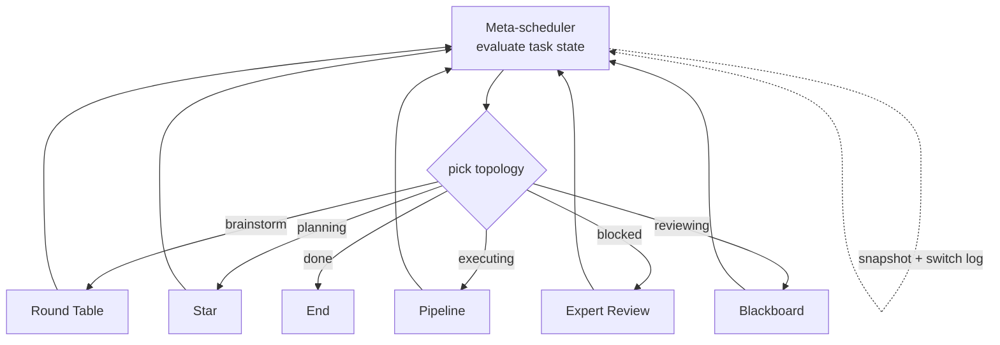
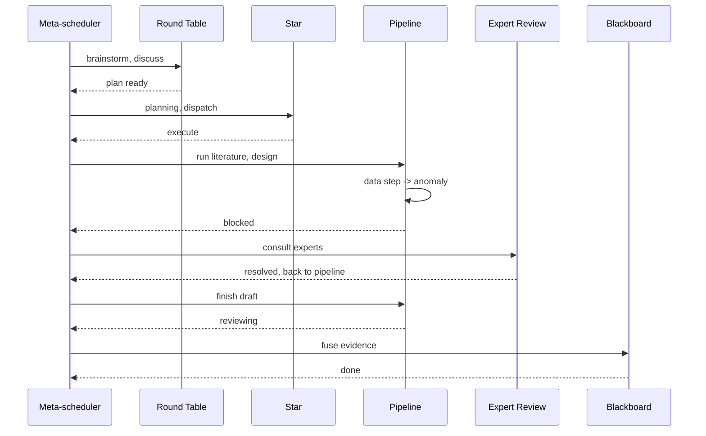

# Dynamic Adaptive Multi-Agent Architecture

> English is the primary documentation. For the Chinese version, see [readme_CN.md](./readme_CN.md).

A runnable implementation of the **dynamic adaptive multi-agent architecture** described in the CSDN article *"多智能体架构详解：动态自适应架构"*. Instead of hard-wiring a fixed collaboration topology before a task starts, a **meta-scheduler** continuously senses the task state and switches between collaboration patterns (round table, star, pipeline, expert review, blackboard) at runtime.

The project is built on **LangGraph**. Since LangGraph is a static graph engine, the dynamic switching is *simulated* with conditional edges: the meta-scheduler node decides the next topology, a conditional edge routes execution to the corresponding topology node, and control returns to the meta-scheduler after each round. Agents are rule-simulated by default, so the demo and tests run out of the box with no API key; a pluggable LLM state evaluator is provided for production use.

## How it works



Demo trajectory of an autonomous research cluster (printed by `main.py`):



## Features

- **Runtime topology switching** driven by a meta-scheduler, no fixed graph for the whole task.
- **Five topology templates**: round-table negotiation, star (central dispatcher), pipeline, expert review (临时会诊小组), blackboard (shared evidence).
- **Stability guards**: switch cooldown (debounce), oscillation detection with switch freeze, per-switch state snapshots, and a switch log.
- **Bounded execution**: max-iteration anti-loop and a fallback that locks onto a stable pipeline topology once the switch count runs away.
- **Pluggable state evaluator**: a rule-based evaluator by default; drop in the LLM evaluator (OpenAI-compatible API) for production-grade state assessment, with automatic fallback to rules when no key is configured.
- **Zero-config demo & test suite**: agents are simulated, so `python main.py` and `python test_adaptive_arch.py` run with no external dependencies beyond LangGraph.

## Dependencies


- `langgraph >= 1.2.0`
- `langchain-core >= 1.8.0`

## Project Structure

```
动态自适应架构/
├── adaptive_arch/                # core package
│   ├── __init__.py               # public API
│   ├── constants.py              # constants (V_ prefixed)
│   ├── state.py                  # AdaptiveState definition + helpers
│   ├── evaluator.py              # StateEvaluator: rule-based + optional LLM
│   ├── meta_scheduler.py         # meta-scheduler (decision + debounce + fallback)
│   ├── snapshot.py               # state snapshot management
│   ├── switch_log.py             # switch log + oscillation detection
│   ├── agents.py                 # simulated role agents
│   ├── graph.py                  # top-level adaptive StateGraph + runner
│   └── topologies/               # topology template library
│       ├── __init__.py
│       ├── base.py
│       ├── round_table.py
│       ├── star.py
│       ├── pipeline.py
│       ├── expert_review.py
│       └── blackboard.py
├── main.py                       # demo entry
├── test_adaptive_arch.py         # test suite (12 cases, no pytest needed)
├── requirements.txt
├── readme.md                     # English doc (primary)
└── readme_CN.md                  # Chinese doc
```

## Usage

Install dependencies:

```bash
pip install -r requirements.txt
```

Run the demo (simulates an autonomous research cluster going through brainstorm → dispatch → pipeline → blocked → expert review → pipeline → blackboard → done):

```bash
python main.py
```

Run the test suite:

```bash
python test_adaptive_arch.py
```

Use the library in your own code:

```python
from adaptive_arch import run_adaptive;

final_state = run_adaptive("研究低功耗传感器网络的数据异常检测方法");
print(final_state["task_result"]);
```

### Optional: LLM-based state evaluation

Set an OpenAI-compatible key and base URL, then pass the LLM evaluator:

```bash
set OPENAI_API_KEY=your_key
set OPENAI_BASE_URL=https://api.openai.com/v1
```

```python
from adaptive_arch import LLMStateEvaluator, run_adaptive;

evaluator = LLMStateEvaluator(model="gpt-4o-mini");
final_state = run_adaptive("your task", evaluator=evaluator);
```

If no key is configured, the evaluator silently degrades to the rule-based one, so the system keeps running.

## Contributing

Issues and pull requests are welcome. When reporting a problem, include the task description and the printed switch trajectory so the scheduling behavior can be reproduced.

## Contact

谙弆悕博士 (Ailan Anjuxi)
- 📫 Email: anjuxi.ME@outlook.com
- 📞 SIP: `sip:anjuxi@sip.linphone.org`

> © 2026 谙弆悕博士（Ailan Anjuxi），All rights reserved.
