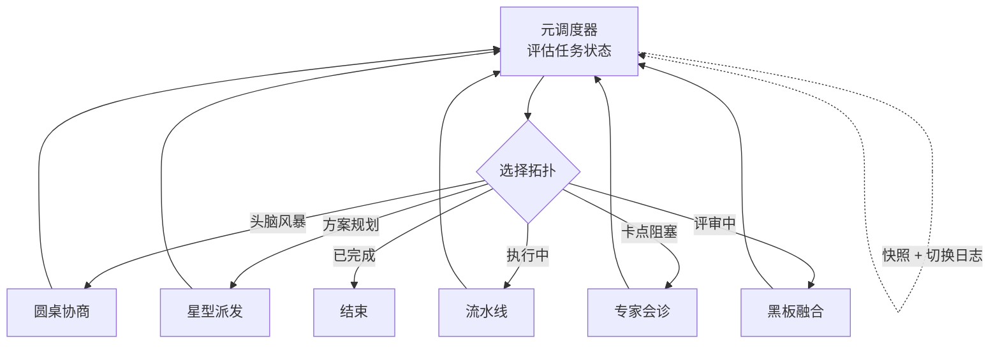
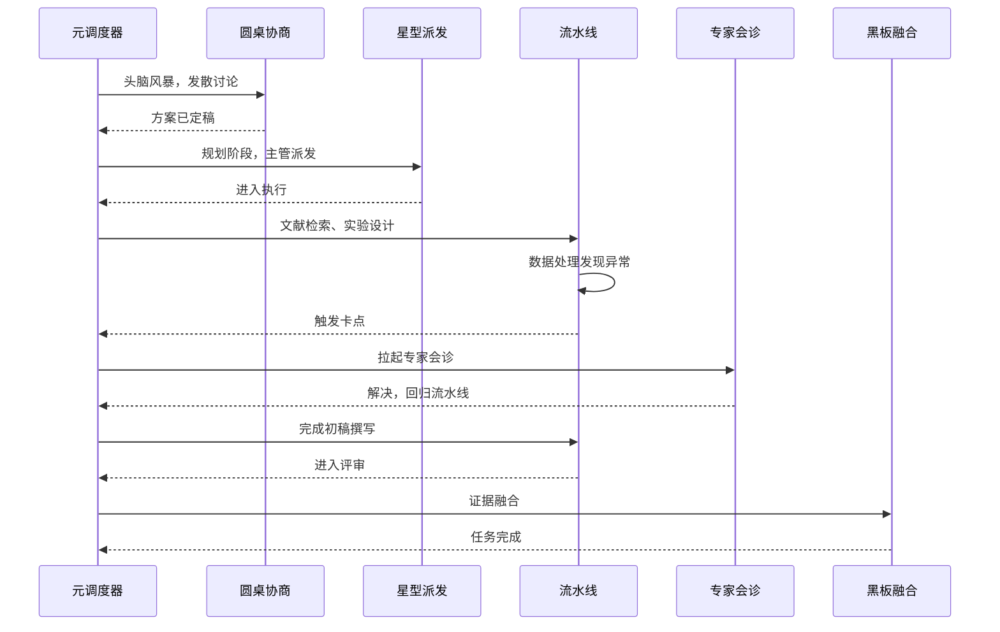

# 动态自适应多智能体架构

> 中文文档，英文主文档见 [readme.md](./readme.md)。

本项目是 CSDN 博文《多智能体架构详解：动态自适应架构》的可运行实现。它不预先写死智能体的协作拓扑，而是由一个**元调度器**持续感知任务状态，在运行时动态切换协作模式（圆桌协商、星型派发、流水线、专家会诊、黑板融合）。

项目基于 **LangGraph** 构建。LangGraph 本身是静态图引擎，不支持运行时真正重构图，因此这里用「条件边 + 拓扑节点」的方式模拟动态切换：元调度器节点选出下一轮拓扑，条件边把执行路由到对应拓扑节点，跑完再回到元调度器重新评估。智能体默认用规则模拟，演示和测试开箱即用、无需 API Key；同时提供可插拔的 LLM 状态评估器，供生产环境接入。

## 工作原理



`main.py` 演示的自主科研集群执行轨迹：



## 功能特性

- **运行时动态切换拓扑**：由元调度器驱动，整个任务没有一张固定的图。
- **五种拓扑模板**：圆桌协商、星型中心化派发、流水线、专家会诊（临时小组）、黑板共享（证据融合）。
- **稳定性防护**：切换冷却防抖、震荡检测并冻结切换、每次切换保存状态快照、记录切换日志。
- **有界执行**：最大迭代步数防死循环，切换次数超限触发兜底降级，锁定到稳定拓扑。
- **可插拔状态评估器**：默认规则版评估任务阶段；可换成 LLM 版（OpenAI 兼容接口）做生产级状态评估，未配置 Key 时自动降级为规则版。
- **零配置演示与测试**：智能体为规则模拟，只需 LangGraph 即可运行 `python main.py` 和 `python test_adaptive_arch.py`。

## 依赖说明


- `langgraph >= 1.2.0`
- `langchain-core >= 1.8.0`

## 项目结构

```
动态自适应架构/
├── adaptive_arch/                # 核心包
│   ├── __init__.py               # 对外暴露的 API
│   ├── constants.py              # 常量定义（V_ 前缀）
│   ├── state.py                  # 自适应状态定义与辅助函数
│   ├── evaluator.py              # 状态评估器：规则版 + 可选 LLM 版
│   ├── meta_scheduler.py         # 元调度器（决策 + 防抖 + 兜底）
│   ├── snapshot.py               # 状态快照管理
│   ├── switch_log.py             # 切换日志与震荡检测
│   ├── agents.py                 # 规则模拟的角色智能体
│   ├── graph.py                  # 顶层自适应图与运行入口
│   └── topologies/               # 拓扑模板库
│       ├── __init__.py
│       ├── base.py
│       ├── round_table.py
│       ├── star.py
│       ├── pipeline.py
│       ├── expert_review.py
│       └── blackboard.py
├── main.py                       # 演示入口
├── test_adaptive_arch.py         # 测试脚本（12 个用例，无需 pytest）
├── requirements.txt
├── readme.md                     # 英文主文档
└── readme_CN.md                  # 中文文档
```

## 使用说明

安装依赖：

```bash
pip install -r requirements.txt
```

运行演示（模拟一个自主科研集群，经历 头脑风暴→星型派发→流水线→卡点→专家会诊→回归流水线→黑板融合→完成）：

```bash
python main.py
```

运行测试：

```bash
python test_adaptive_arch.py
```

在自己的代码里调用：

```python
from adaptive_arch import run_adaptive;

final_state = run_adaptive("研究低功耗传感器网络的数据异常检测方法");
print(final_state["task_result"]);
```

### 可选：用 LLM 做状态评估

设置 OpenAI 兼容的 Key 与接口地址，再传入 LLM 评估器：

```bash
set OPENAI_API_KEY=your_key
set OPENAI_BASE_URL=https://api.openai.com/v1
```

```python
from adaptive_arch import LLMStateEvaluator, run_adaptive;

evaluator = LLMStateEvaluator(model="gpt-4o-mini");
final_state = run_adaptive("你的任务", evaluator=evaluator);
```

未配置 Key 时评估器会自动降级到规则版，系统照常运行。

## 贡献指南

欢迎提交 Issue 和 Pull Request。反馈问题时请附上任务描述和打印出来的切换轨迹，便于复现调度行为。

## 联系作者

谙弆悕博士（Ailan Anjuxi）
- 📫 邮箱：anjuxi.ME@outlook.com
- 📞 SIP 电话：`sip:anjuxi@sip.linphone.org`

> © 2026 谙弆悕博士（Ailan Anjuxi），All rights reserved.
